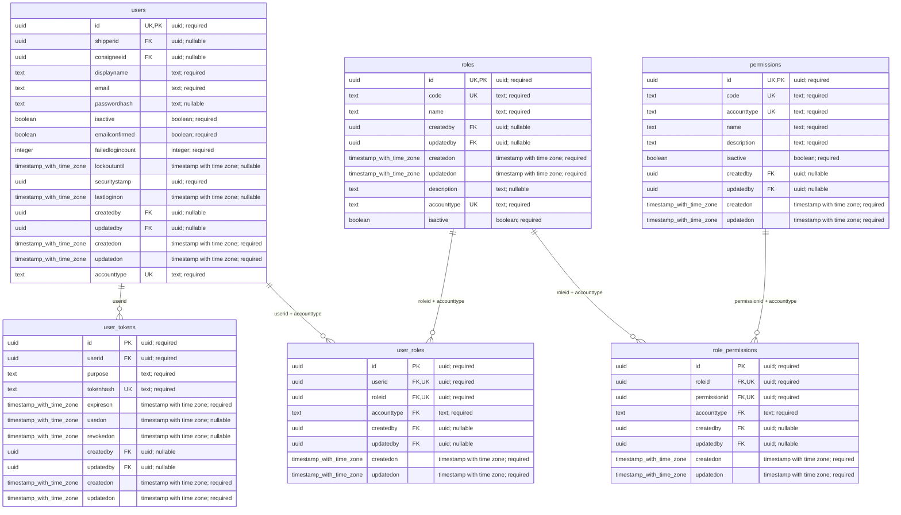
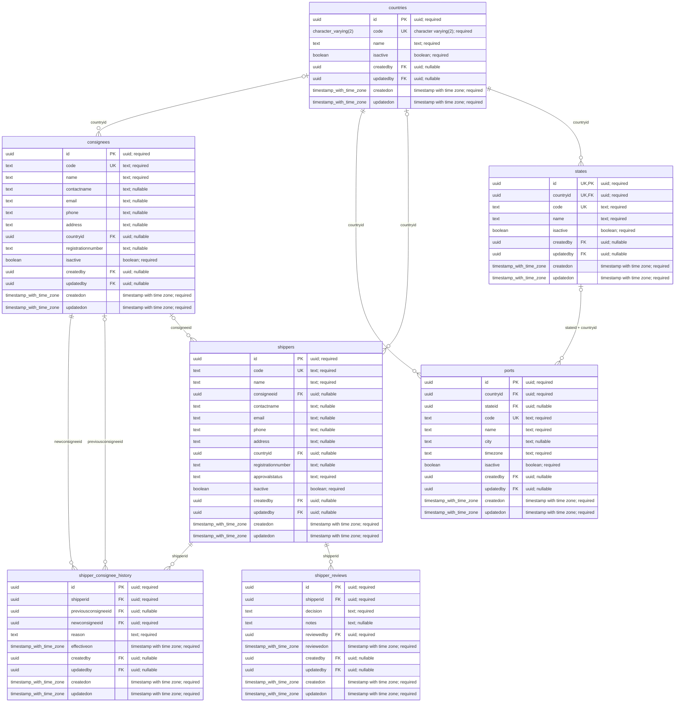

# Kodiak — complete database diagram

Latest design after migration 005: **29 tables**, dynamic roles, and all columns. Generated from a temporary PostgreSQL catalog, not handwritten approximations. No EF entities or migrations were created.

Open **DIAGRAM.html** for searchable, zoomable diagrams with exact SQL types, nullability, constraints and indexes.

PK = primary key; FK = foreign key; UK = participates in a UNIQUE constraint (possibly composite). Audit actor links are omitted from diagram lines for readability; createdby/updatedby on every table reference users.id.

Mermaid type labels use underscores in place of spaces; column comments retain the exact PostgreSQL type and required/nullable state. SQL defaults and full composite constraints are in the HTML inspector.

## Access & roles



## Companies & locations



## Bookings & tracking

```mermaid
erDiagram
  bookings {
    uuid id PK "uuid; required"
    text bookingnumber UK "text; required"
    uuid shipperid FK "uuid; required"
    uuid consigneeid FK "uuid; required"
    uuid originportid FK "uuid; required"
    uuid destinationportid FK "uuid; required"
    text status  "text; required"
    text customerreference  "text; nullable"
    text cargodescription  "text; required"
    text handlinginstructions  "text; nullable"
    date requesteddeparture  "date; nullable"
    date requestedarrival  "date; nullable"
    timestamp_with_time_zone submittedon  "timestamp with time zone; nullable"
    uuid createdby FK "uuid; nullable"
    uuid updatedby FK "uuid; nullable"
    timestamp_with_time_zone createdon  "timestamp with time zone; required"
    timestamp_with_time_zone updatedon  "timestamp with time zone; required"
  }
  booking_items {
    uuid id UK,PK "uuid; required"
    uuid bookingid FK,UK "uuid; required"
    uuid containertypeid FK "uuid; required"
    integer quantity  "integer; required"
    numeric(14_3) totalweightkg  "numeric(14,3); nullable"
    numeric(14_3) totalvolume_m3  "numeric(14,3); nullable"
    integer totalpackages  "integer; nullable"
    text cargodescription  "text; nullable"
    uuid createdby FK "uuid; nullable"
    uuid updatedby FK "uuid; nullable"
    timestamp_with_time_zone createdon  "timestamp with time zone; required"
    timestamp_with_time_zone updatedon  "timestamp with time zone; required"
  }
  booking_reviews {
    uuid id PK "uuid; required"
    uuid bookingid FK "uuid; required"
    text previousstatus  "text; required"
    text newstatus  "text; required"
    text reason  "text; nullable"
    uuid reviewedby FK "uuid; required"
    timestamp_with_time_zone reviewedon  "timestamp with time zone; required"
    uuid createdby FK "uuid; nullable"
    uuid updatedby FK "uuid; nullable"
    timestamp_with_time_zone createdon  "timestamp with time zone; required"
    timestamp_with_time_zone updatedon  "timestamp with time zone; required"
  }
  containers {
    uuid id PK "uuid; required"
    character_varying(11) containernumber UK "character varying(11); required"
    uuid containertypeid FK "uuid; required"
    text notes  "text; nullable"
    boolean isactive  "boolean; required"
    uuid createdby FK "uuid; nullable"
    uuid updatedby FK "uuid; nullable"
    timestamp_with_time_zone createdon  "timestamp with time zone; required"
    timestamp_with_time_zone updatedon  "timestamp with time zone; required"
  }
  container_types {
    uuid id PK "uuid; required"
    text code UK "text; required"
    text name  "text; required"
    boolean isrefrigerated  "boolean; required"
    boolean isactive  "boolean; required"
    uuid createdby FK "uuid; nullable"
    uuid updatedby FK "uuid; nullable"
    timestamp_with_time_zone createdon  "timestamp with time zone; required"
    timestamp_with_time_zone updatedon  "timestamp with time zone; required"
  }
  container_journeys {
    uuid id PK "uuid; required"
    text journeynumber UK "text; required"
    uuid bookingid FK "uuid; required"
    uuid bookingitemid FK "uuid; required"
    uuid containerid FK "uuid; nullable"
    text sealnumber  "text; nullable"
    text billofladingnumber  "text; nullable"
    timestamp_with_time_zone expecteddeparture  "timestamp with time zone; nullable"
    timestamp_with_time_zone expectedarrival  "timestamp with time zone; nullable"
    timestamp_with_time_zone endedon  "timestamp with time zone; nullable"
    text outcome  "text; nullable"
    uuid returnofjourneyid FK "uuid; nullable"
    uuid createdby FK "uuid; nullable"
    uuid updatedby FK "uuid; nullable"
    timestamp_with_time_zone createdon  "timestamp with time zone; required"
    timestamp_with_time_zone updatedon  "timestamp with time zone; required"
  }
  journey_legs {
    uuid id UK,PK "uuid; required"
    uuid journeyid UK,FK "uuid; required"
    integer sequence UK "integer; required"
    uuid originportid FK "uuid; required"
    uuid destinationportid FK "uuid; required"
    text vesselname  "text; nullable"
    text voyagenumber  "text; nullable"
    timestamp_with_time_zone expecteddeparture  "timestamp with time zone; nullable"
    timestamp_with_time_zone expectedarrival  "timestamp with time zone; nullable"
    timestamp_with_time_zone actualdeparture  "timestamp with time zone; nullable"
    timestamp_with_time_zone actualarrival  "timestamp with time zone; nullable"
    uuid createdby FK "uuid; nullable"
    uuid updatedby FK "uuid; nullable"
    timestamp_with_time_zone createdon  "timestamp with time zone; required"
    timestamp_with_time_zone updatedon  "timestamp with time zone; required"
  }
  tracking_events {
    uuid id UK,PK "uuid; required"
    uuid journeyid UK,FK "uuid; required"
    uuid legid FK "uuid; nullable"
    uuid statusid FK "uuid; required"
    timestamp_with_time_zone occurredon  "timestamp with time zone; required"
    uuid portid FK "uuid; nullable"
    text locationdescription  "text; nullable"
    text informationsource  "text; nullable"
    text publicnotes  "text; nullable"
    text internalnotes  "text; nullable"
    uuid supersedeseventid FK,UK "uuid; nullable"
    text correctionreason  "text; nullable"
    uuid createdby FK "uuid; nullable"
    uuid updatedby FK "uuid; nullable"
    timestamp_with_time_zone createdon  "timestamp with time zone; required"
    timestamp_with_time_zone updatedon  "timestamp with time zone; required"
  }
  tracking_statuses {
    uuid id PK "uuid; required"
    text code UK "text; required"
    text name  "text; required"
    integer displayorder  "integer; required"
    boolean isterminal  "boolean; required"
    boolean isactive  "boolean; required"
    uuid createdby FK "uuid; nullable"
    uuid updatedby FK "uuid; nullable"
    timestamp_with_time_zone createdon  "timestamp with time zone; required"
    timestamp_with_time_zone updatedon  "timestamp with time zone; required"
  }
  bookings ||--o{ booking_items : "bookingid"
  container_types ||--o{ booking_items : "containertypeid"
  bookings ||--o{ booking_reviews : "bookingid"
  bookings ||--o{ container_journeys : "bookingid"
  booking_items ||--o{ container_journeys : "bookingitemid + bookingid"
  containers |o--o{ container_journeys : "containerid"
  container_journeys |o--o{ container_journeys : "returnofjourneyid"
  container_types ||--o{ containers : "containertypeid"
  container_journeys ||--o{ journey_legs : "journeyid"
  container_journeys ||--o{ tracking_events : "journeyid"
  journey_legs |o--o{ tracking_events : "legid + journeyid"
  tracking_statuses ||--o{ tracking_events : "statusid"
  tracking_events |o--o| tracking_events : "supersedeseventid + journeyid"
```



## Restrictions & documents

```mermaid
erDiagram
  journey_holds {
    uuid id PK "uuid; required"
    uuid journeyid FK "uuid; required"
    uuid reasonid FK "uuid; required"
    text internalreason  "text; required"
    text publicreason  "text; nullable"
    timestamp_with_time_zone heldon  "timestamp with time zone; required"
    uuid heldby FK "uuid; required"
    date reviewon  "date; nullable"
    timestamp_with_time_zone releasedon  "timestamp with time zone; nullable"
    uuid releasedby FK "uuid; nullable"
    text releasereason  "text; nullable"
    uuid createdby FK "uuid; nullable"
    uuid updatedby FK "uuid; nullable"
    timestamp_with_time_zone createdon  "timestamp with time zone; required"
    timestamp_with_time_zone updatedon  "timestamp with time zone; required"
  }
  blacklists {
    uuid id PK "uuid; required"
    uuid shipperid FK "uuid; nullable"
    uuid containerid FK "uuid; nullable"
    uuid reasonid FK "uuid; required"
    text internalreason  "text; required"
    text publicreason  "text; nullable"
    timestamp_with_time_zone blockedon  "timestamp with time zone; required"
    uuid blockedby FK "uuid; required"
    date reviewon  "date; nullable"
    timestamp_with_time_zone releasedon  "timestamp with time zone; nullable"
    uuid releasedby FK "uuid; nullable"
    text releasereason  "text; nullable"
    uuid createdby FK "uuid; nullable"
    uuid updatedby FK "uuid; nullable"
    timestamp_with_time_zone createdon  "timestamp with time zone; required"
    timestamp_with_time_zone updatedon  "timestamp with time zone; required"
  }
  restriction_reasons {
    uuid id PK "uuid; required"
    text code UK "text; required"
    text name  "text; required"
    boolean isactive  "boolean; required"
    uuid createdby FK "uuid; nullable"
    uuid updatedby FK "uuid; nullable"
    timestamp_with_time_zone createdon  "timestamp with time zone; required"
    timestamp_with_time_zone updatedon  "timestamp with time zone; required"
  }
  documents {
    uuid id PK "uuid; required"
    uuid documenttypeid FK "uuid; required"
    uuid shipperid FK "uuid; nullable"
    uuid bookingid FK "uuid; nullable"
    uuid journeyid FK "uuid; nullable"
    text originalfilename  "text; required"
    text storagekey UK "text; required"
    text contenttype  "text; required"
    bigint sizebytes  "bigint; required"
    character_varying(64) sha256  "character varying(64); required"
    text visibility  "text; required"
    text scanstatus  "text; required"
    uuid createdby FK "uuid; nullable"
    uuid updatedby FK "uuid; nullable"
    timestamp_with_time_zone createdon  "timestamp with time zone; required"
    timestamp_with_time_zone updatedon  "timestamp with time zone; required"
  }
  document_types {
    uuid id PK "uuid; required"
    text code UK "text; required"
    text name  "text; required"
    boolean isactive  "boolean; required"
    uuid createdby FK "uuid; nullable"
    uuid updatedby FK "uuid; nullable"
    timestamp_with_time_zone createdon  "timestamp with time zone; required"
    timestamp_with_time_zone updatedon  "timestamp with time zone; required"
  }
  notifications {
    uuid id PK "uuid; required"
    uuid recipientid FK "uuid; required"
    uuid bookingid FK "uuid; nullable"
    uuid journeyid FK "uuid; nullable"
    text title  "text; required"
    text message  "text; required"
    timestamp_with_time_zone readon  "timestamp with time zone; nullable"
    uuid createdby FK "uuid; nullable"
    uuid updatedby FK "uuid; nullable"
    timestamp_with_time_zone createdon  "timestamp with time zone; required"
    timestamp_with_time_zone updatedon  "timestamp with time zone; required"
  }
  audit_logs {
    uuid id PK "uuid; required"
    text entityname  "text; required"
    uuid entityid  "uuid; required"
    text action  "text; required"
    jsonb changedfields  "jsonb; required"
    text requestid  "text; nullable"
    text reason  "text; nullable"
    uuid createdby FK "uuid; nullable"
    uuid updatedby FK "uuid; nullable"
    timestamp_with_time_zone createdon  "timestamp with time zone; required"
    timestamp_with_time_zone updatedon  "timestamp with time zone; required"
  }
  restriction_reasons ||--o{ blacklists : "reasonid"
  document_types ||--o{ documents : "documenttypeid"
  restriction_reasons ||--o{ journey_holds : "reasonid"
```



## All tables and business relationships

```mermaid
erDiagram
  audit_logs {
    uuid id PK "uuid; required"
    text entityname  "text; required"
    uuid entityid  "uuid; required"
    text action  "text; required"
    jsonb changedfields  "jsonb; required"
    text requestid  "text; nullable"
    text reason  "text; nullable"
    uuid createdby FK "uuid; nullable"
    uuid updatedby FK "uuid; nullable"
    timestamp_with_time_zone createdon  "timestamp with time zone; required"
    timestamp_with_time_zone updatedon  "timestamp with time zone; required"
  }
  blacklists {
    uuid id PK "uuid; required"
    uuid shipperid FK "uuid; nullable"
    uuid containerid FK "uuid; nullable"
    uuid reasonid FK "uuid; required"
    text internalreason  "text; required"
    text publicreason  "text; nullable"
    timestamp_with_time_zone blockedon  "timestamp with time zone; required"
    uuid blockedby FK "uuid; required"
    date reviewon  "date; nullable"
    timestamp_with_time_zone releasedon  "timestamp with time zone; nullable"
    uuid releasedby FK "uuid; nullable"
    text releasereason  "text; nullable"
    uuid createdby FK "uuid; nullable"
    uuid updatedby FK "uuid; nullable"
    timestamp_with_time_zone createdon  "timestamp with time zone; required"
    timestamp_with_time_zone updatedon  "timestamp with time zone; required"
  }
  booking_items {
    uuid id UK,PK "uuid; required"
    uuid bookingid FK,UK "uuid; required"
    uuid containertypeid FK "uuid; required"
    integer quantity  "integer; required"
    numeric(14_3) totalweightkg  "numeric(14,3); nullable"
    numeric(14_3) totalvolume_m3  "numeric(14,3); nullable"
    integer totalpackages  "integer; nullable"
    text cargodescription  "text; nullable"
    uuid createdby FK "uuid; nullable"
    uuid updatedby FK "uuid; nullable"
    timestamp_with_time_zone createdon  "timestamp with time zone; required"
    timestamp_with_time_zone updatedon  "timestamp with time zone; required"
  }
  booking_reviews {
    uuid id PK "uuid; required"
    uuid bookingid FK "uuid; required"
    text previousstatus  "text; required"
    text newstatus  "text; required"
    text reason  "text; nullable"
    uuid reviewedby FK "uuid; required"
    timestamp_with_time_zone reviewedon  "timestamp with time zone; required"
    uuid createdby FK "uuid; nullable"
    uuid updatedby FK "uuid; nullable"
    timestamp_with_time_zone createdon  "timestamp with time zone; required"
    timestamp_with_time_zone updatedon  "timestamp with time zone; required"
  }
  bookings {
    uuid id PK "uuid; required"
    text bookingnumber UK "text; required"
    uuid shipperid FK "uuid; required"
    uuid consigneeid FK "uuid; required"
    uuid originportid FK "uuid; required"
    uuid destinationportid FK "uuid; required"
    text status  "text; required"
    text customerreference  "text; nullable"
    text cargodescription  "text; required"
    text handlinginstructions  "text; nullable"
    date requesteddeparture  "date; nullable"
    date requestedarrival  "date; nullable"
    timestamp_with_time_zone submittedon  "timestamp with time zone; nullable"
    uuid createdby FK "uuid; nullable"
    uuid updatedby FK "uuid; nullable"
    timestamp_with_time_zone createdon  "timestamp with time zone; required"
    timestamp_with_time_zone updatedon  "timestamp with time zone; required"
  }
  consignees {
    uuid id PK "uuid; required"
    text code UK "text; required"
    text name  "text; required"
    text contactname  "text; nullable"
    text email  "text; nullable"
    text phone  "text; nullable"
    text address  "text; nullable"
    uuid countryid FK "uuid; nullable"
    text registrationnumber  "text; nullable"
    boolean isactive  "boolean; required"
    uuid createdby FK "uuid; nullable"
    uuid updatedby FK "uuid; nullable"
    timestamp_with_time_zone createdon  "timestamp with time zone; required"
    timestamp_with_time_zone updatedon  "timestamp with time zone; required"
  }
  container_journeys {
    uuid id PK "uuid; required"
    text journeynumber UK "text; required"
    uuid bookingid FK "uuid; required"
    uuid bookingitemid FK "uuid; required"
    uuid containerid FK "uuid; nullable"
    text sealnumber  "text; nullable"
    text billofladingnumber  "text; nullable"
    timestamp_with_time_zone expecteddeparture  "timestamp with time zone; nullable"
    timestamp_with_time_zone expectedarrival  "timestamp with time zone; nullable"
    timestamp_with_time_zone endedon  "timestamp with time zone; nullable"
    text outcome  "text; nullable"
    uuid returnofjourneyid FK "uuid; nullable"
    uuid createdby FK "uuid; nullable"
    uuid updatedby FK "uuid; nullable"
    timestamp_with_time_zone createdon  "timestamp with time zone; required"
    timestamp_with_time_zone updatedon  "timestamp with time zone; required"
  }
  container_types {
    uuid id PK "uuid; required"
    text code UK "text; required"
    text name  "text; required"
    boolean isrefrigerated  "boolean; required"
    boolean isactive  "boolean; required"
    uuid createdby FK "uuid; nullable"
    uuid updatedby FK "uuid; nullable"
    timestamp_with_time_zone createdon  "timestamp with time zone; required"
    timestamp_with_time_zone updatedon  "timestamp with time zone; required"
  }
  containers {
    uuid id PK "uuid; required"
    character_varying(11) containernumber UK "character varying(11); required"
    uuid containertypeid FK "uuid; required"
    text notes  "text; nullable"
    boolean isactive  "boolean; required"
    uuid createdby FK "uuid; nullable"
    uuid updatedby FK "uuid; nullable"
    timestamp_with_time_zone createdon  "timestamp with time zone; required"
    timestamp_with_time_zone updatedon  "timestamp with time zone; required"
  }
  countries {
    uuid id PK "uuid; required"
    character_varying(2) code UK "character varying(2); required"
    text name  "text; required"
    boolean isactive  "boolean; required"
    uuid createdby FK "uuid; nullable"
    uuid updatedby FK "uuid; nullable"
    timestamp_with_time_zone createdon  "timestamp with time zone; required"
    timestamp_with_time_zone updatedon  "timestamp with time zone; required"
  }
  document_types {
    uuid id PK "uuid; required"
    text code UK "text; required"
    text name  "text; required"
    boolean isactive  "boolean; required"
    uuid createdby FK "uuid; nullable"
    uuid updatedby FK "uuid; nullable"
    timestamp_with_time_zone createdon  "timestamp with time zone; required"
    timestamp_with_time_zone updatedon  "timestamp with time zone; required"
  }
  documents {
    uuid id PK "uuid; required"
    uuid documenttypeid FK "uuid; required"
    uuid shipperid FK "uuid; nullable"
    uuid bookingid FK "uuid; nullable"
    uuid journeyid FK "uuid; nullable"
    text originalfilename  "text; required"
    text storagekey UK "text; required"
    text contenttype  "text; required"
    bigint sizebytes  "bigint; required"
    character_varying(64) sha256  "character varying(64); required"
    text visibility  "text; required"
    text scanstatus  "text; required"
    uuid createdby FK "uuid; nullable"
    uuid updatedby FK "uuid; nullable"
    timestamp_with_time_zone createdon  "timestamp with time zone; required"
    timestamp_with_time_zone updatedon  "timestamp with time zone; required"
  }
  journey_holds {
    uuid id PK "uuid; required"
    uuid journeyid FK "uuid; required"
    uuid reasonid FK "uuid; required"
    text internalreason  "text; required"
    text publicreason  "text; nullable"
    timestamp_with_time_zone heldon  "timestamp with time zone; required"
    uuid heldby FK "uuid; required"
    date reviewon  "date; nullable"
    timestamp_with_time_zone releasedon  "timestamp with time zone; nullable"
    uuid releasedby FK "uuid; nullable"
    text releasereason  "text; nullable"
    uuid createdby FK "uuid; nullable"
    uuid updatedby FK "uuid; nullable"
    timestamp_with_time_zone createdon  "timestamp with time zone; required"
    timestamp_with_time_zone updatedon  "timestamp with time zone; required"
  }
  journey_legs {
    uuid id UK,PK "uuid; required"
    uuid journeyid UK,FK "uuid; required"
    integer sequence UK "integer; required"
    uuid originportid FK "uuid; required"
    uuid destinationportid FK "uuid; required"
    text vesselname  "text; nullable"
    text voyagenumber  "text; nullable"
    timestamp_with_time_zone expecteddeparture  "timestamp with time zone; nullable"
    timestamp_with_time_zone expectedarrival  "timestamp with time zone; nullable"
    timestamp_with_time_zone actualdeparture  "timestamp with time zone; nullable"
    timestamp_with_time_zone actualarrival  "timestamp with time zone; nullable"
    uuid createdby FK "uuid; nullable"
    uuid updatedby FK "uuid; nullable"
    timestamp_with_time_zone createdon  "timestamp with time zone; required"
    timestamp_with_time_zone updatedon  "timestamp with time zone; required"
  }
  notifications {
    uuid id PK "uuid; required"
    uuid recipientid FK "uuid; required"
    uuid bookingid FK "uuid; nullable"
    uuid journeyid FK "uuid; nullable"
    text title  "text; required"
    text message  "text; required"
    timestamp_with_time_zone readon  "timestamp with time zone; nullable"
    uuid createdby FK "uuid; nullable"
    uuid updatedby FK "uuid; nullable"
    timestamp_with_time_zone createdon  "timestamp with time zone; required"
    timestamp_with_time_zone updatedon  "timestamp with time zone; required"
  }
  permissions {
    uuid id UK,PK "uuid; required"
    text code UK "text; required"
    text accounttype UK "text; required"
    text name  "text; required"
    text description  "text; required"
    boolean isactive  "boolean; required"
    uuid createdby FK "uuid; nullable"
    uuid updatedby FK "uuid; nullable"
    timestamp_with_time_zone createdon  "timestamp with time zone; required"
    timestamp_with_time_zone updatedon  "timestamp with time zone; required"
  }
  ports {
    uuid id PK "uuid; required"
    uuid countryid FK "uuid; required"
    uuid stateid FK "uuid; nullable"
    text code UK "text; required"
    text name  "text; required"
    text city  "text; nullable"
    text timezone  "text; required"
    boolean isactive  "boolean; required"
    uuid createdby FK "uuid; nullable"
    uuid updatedby FK "uuid; nullable"
    timestamp_with_time_zone createdon  "timestamp with time zone; required"
    timestamp_with_time_zone updatedon  "timestamp with time zone; required"
  }
  restriction_reasons {
    uuid id PK "uuid; required"
    text code UK "text; required"
    text name  "text; required"
    boolean isactive  "boolean; required"
    uuid createdby FK "uuid; nullable"
    uuid updatedby FK "uuid; nullable"
    timestamp_with_time_zone createdon  "timestamp with time zone; required"
    timestamp_with_time_zone updatedon  "timestamp with time zone; required"
  }
  role_permissions {
    uuid id PK "uuid; required"
    uuid roleid FK,UK "uuid; required"
    uuid permissionid FK,UK "uuid; required"
    text accounttype FK "text; required"
    uuid createdby FK "uuid; nullable"
    uuid updatedby FK "uuid; nullable"
    timestamp_with_time_zone createdon  "timestamp with time zone; required"
    timestamp_with_time_zone updatedon  "timestamp with time zone; required"
  }
  roles {
    uuid id UK,PK "uuid; required"
    text code UK "text; required"
    text name  "text; required"
    uuid createdby FK "uuid; nullable"
    uuid updatedby FK "uuid; nullable"
    timestamp_with_time_zone createdon  "timestamp with time zone; required"
    timestamp_with_time_zone updatedon  "timestamp with time zone; required"
    text description  "text; nullable"
    text accounttype UK "text; required"
    boolean isactive  "boolean; required"
  }
  shipper_consignee_history {
    uuid id PK "uuid; required"
    uuid shipperid FK "uuid; required"
    uuid previousconsigneeid FK "uuid; nullable"
    uuid newconsigneeid FK "uuid; required"
    text reason  "text; required"
    timestamp_with_time_zone effectiveon  "timestamp with time zone; required"
    uuid createdby FK "uuid; nullable"
    uuid updatedby FK "uuid; nullable"
    timestamp_with_time_zone createdon  "timestamp with time zone; required"
    timestamp_with_time_zone updatedon  "timestamp with time zone; required"
  }
  shipper_reviews {
    uuid id PK "uuid; required"
    uuid shipperid FK "uuid; required"
    text decision  "text; required"
    text notes  "text; nullable"
    uuid reviewedby FK "uuid; required"
    timestamp_with_time_zone reviewedon  "timestamp with time zone; required"
    uuid createdby FK "uuid; nullable"
    uuid updatedby FK "uuid; nullable"
    timestamp_with_time_zone createdon  "timestamp with time zone; required"
    timestamp_with_time_zone updatedon  "timestamp with time zone; required"
  }
  shippers {
    uuid id PK "uuid; required"
    text code UK "text; required"
    text name  "text; required"
    uuid consigneeid FK "uuid; nullable"
    text contactname  "text; nullable"
    text email  "text; nullable"
    text phone  "text; nullable"
    text address  "text; nullable"
    uuid countryid FK "uuid; nullable"
    text registrationnumber  "text; nullable"
    text approvalstatus  "text; required"
    boolean isactive  "boolean; required"
    uuid createdby FK "uuid; nullable"
    uuid updatedby FK "uuid; nullable"
    timestamp_with_time_zone createdon  "timestamp with time zone; required"
    timestamp_with_time_zone updatedon  "timestamp with time zone; required"
  }
  states {
    uuid id UK,PK "uuid; required"
    uuid countryid UK,FK "uuid; required"
    text code UK "text; required"
    text name  "text; required"
    boolean isactive  "boolean; required"
    uuid createdby FK "uuid; nullable"
    uuid updatedby FK "uuid; nullable"
    timestamp_with_time_zone createdon  "timestamp with time zone; required"
    timestamp_with_time_zone updatedon  "timestamp with time zone; required"
  }
  tracking_events {
    uuid id UK,PK "uuid; required"
    uuid journeyid UK,FK "uuid; required"
    uuid legid FK "uuid; nullable"
    uuid statusid FK "uuid; required"
    timestamp_with_time_zone occurredon  "timestamp with time zone; required"
    uuid portid FK "uuid; nullable"
    text locationdescription  "text; nullable"
    text informationsource  "text; nullable"
    text publicnotes  "text; nullable"
    text internalnotes  "text; nullable"
    uuid supersedeseventid FK,UK "uuid; nullable"
    text correctionreason  "text; nullable"
    uuid createdby FK "uuid; nullable"
    uuid updatedby FK "uuid; nullable"
    timestamp_with_time_zone createdon  "timestamp with time zone; required"
    timestamp_with_time_zone updatedon  "timestamp with time zone; required"
  }
  tracking_statuses {
    uuid id PK "uuid; required"
    text code UK "text; required"
    text name  "text; required"
    integer displayorder  "integer; required"
    boolean isterminal  "boolean; required"
    boolean isactive  "boolean; required"
    uuid createdby FK "uuid; nullable"
    uuid updatedby FK "uuid; nullable"
    timestamp_with_time_zone createdon  "timestamp with time zone; required"
    timestamp_with_time_zone updatedon  "timestamp with time zone; required"
  }
  user_roles {
    uuid id PK "uuid; required"
    uuid userid FK,UK "uuid; required"
    uuid roleid FK,UK "uuid; required"
    text accounttype FK "text; required"
    uuid createdby FK "uuid; nullable"
    uuid updatedby FK "uuid; nullable"
    timestamp_with_time_zone createdon  "timestamp with time zone; required"
    timestamp_with_time_zone updatedon  "timestamp with time zone; required"
  }
  user_tokens {
    uuid id PK "uuid; required"
    uuid userid FK "uuid; required"
    text purpose  "text; required"
    text tokenhash UK "text; required"
    timestamp_with_time_zone expireson  "timestamp with time zone; required"
    timestamp_with_time_zone usedon  "timestamp with time zone; nullable"
    timestamp_with_time_zone revokedon  "timestamp with time zone; nullable"
    uuid createdby FK "uuid; nullable"
    uuid updatedby FK "uuid; nullable"
    timestamp_with_time_zone createdon  "timestamp with time zone; required"
    timestamp_with_time_zone updatedon  "timestamp with time zone; required"
  }
  users {
    uuid id UK,PK "uuid; required"
    uuid shipperid FK "uuid; nullable"
    uuid consigneeid FK "uuid; nullable"
    text displayname  "text; required"
    text email  "text; required"
    text passwordhash  "text; nullable"
    boolean isactive  "boolean; required"
    boolean emailconfirmed  "boolean; required"
    integer failedlogincount  "integer; required"
    timestamp_with_time_zone lockoutuntil  "timestamp with time zone; nullable"
    uuid securitystamp  "uuid; required"
    timestamp_with_time_zone lastloginon  "timestamp with time zone; nullable"
    uuid createdby FK "uuid; nullable"
    uuid updatedby FK "uuid; nullable"
    timestamp_with_time_zone createdon  "timestamp with time zone; required"
    timestamp_with_time_zone updatedon  "timestamp with time zone; required"
    text accounttype UK "text; required"
  }
  users ||--o{ blacklists : "blockedby"
  containers |o--o{ blacklists : "containerid"
  restriction_reasons ||--o{ blacklists : "reasonid"
  users |o--o{ blacklists : "releasedby"
  shippers |o--o{ blacklists : "shipperid"
  bookings ||--o{ booking_items : "bookingid"
  container_types ||--o{ booking_items : "containertypeid"
  bookings ||--o{ booking_reviews : "bookingid"
  users ||--o{ booking_reviews : "reviewedby"
  consignees ||--o{ bookings : "consigneeid"
  ports ||--o{ bookings : "destinationportid"
  ports ||--o{ bookings : "originportid"
  shippers ||--o{ bookings : "shipperid"
  countries |o--o{ consignees : "countryid"
  bookings ||--o{ container_journeys : "bookingid"
  booking_items ||--o{ container_journeys : "bookingitemid + bookingid"
  containers |o--o{ container_journeys : "containerid"
  container_journeys |o--o{ container_journeys : "returnofjourneyid"
  container_types ||--o{ containers : "containertypeid"
  bookings |o--o{ documents : "bookingid"
  document_types ||--o{ documents : "documenttypeid"
  container_journeys |o--o{ documents : "journeyid"
  shippers |o--o{ documents : "shipperid"
  users ||--o{ journey_holds : "heldby"
  container_journeys ||--o{ journey_holds : "journeyid"
  restriction_reasons ||--o{ journey_holds : "reasonid"
  users |o--o{ journey_holds : "releasedby"
  ports ||--o{ journey_legs : "destinationportid"
  container_journeys ||--o{ journey_legs : "journeyid"
  ports ||--o{ journey_legs : "originportid"
  bookings |o--o{ notifications : "bookingid"
  container_journeys |o--o{ notifications : "journeyid"
  users ||--o{ notifications : "recipientid"
  countries ||--o{ ports : "countryid"
  states |o--o{ ports : "stateid + countryid"
  permissions ||--o{ role_permissions : "permissionid + accounttype"
  roles ||--o{ role_permissions : "roleid + accounttype"
  consignees ||--o{ shipper_consignee_history : "newconsigneeid"
  consignees |o--o{ shipper_consignee_history : "previousconsigneeid"
  shippers ||--o{ shipper_consignee_history : "shipperid"
  users ||--o{ shipper_reviews : "reviewedby"
  shippers ||--o{ shipper_reviews : "shipperid"
  consignees |o--o{ shippers : "consigneeid"
  countries |o--o{ shippers : "countryid"
  countries ||--o{ states : "countryid"
  container_journeys ||--o{ tracking_events : "journeyid"
  journey_legs |o--o{ tracking_events : "legid + journeyid"
  ports |o--o{ tracking_events : "portid"
  tracking_statuses ||--o{ tracking_events : "statusid"
  tracking_events |o--o| tracking_events : "supersedeseventid + journeyid"
  roles ||--o{ user_roles : "roleid + accounttype"
  users ||--o{ user_roles : "userid + accounttype"
  users ||--o{ user_tokens : "userid"
  consignees |o--o{ users : "consigneeid"
  shippers |o--o{ users : "shipperid"
```
