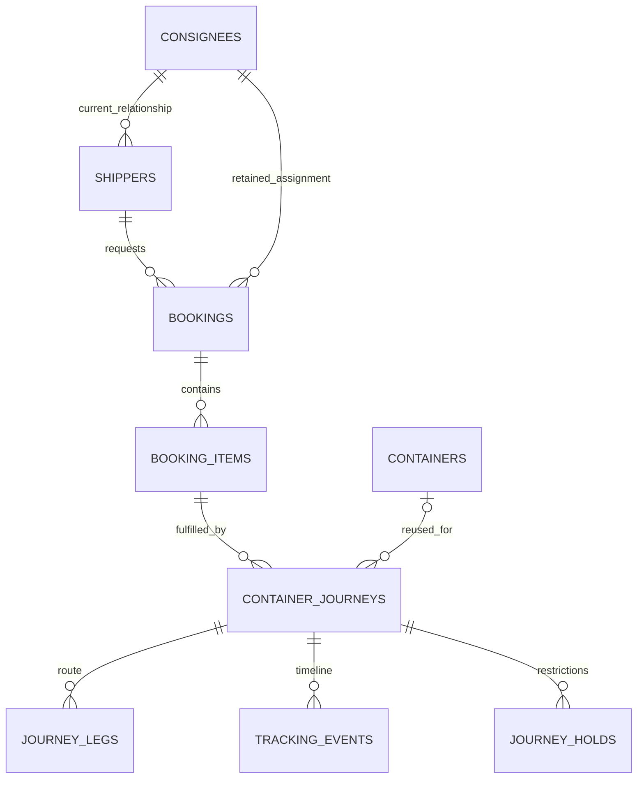

# Kodiak production database design

**Visual reference:** Open [interactive database diagram](DIAGRAM.html) for all **29 tables and 343 columns**, exact PostgreSQL types, nullability, keys, relationships, defaults, constraints and indexes. It supports module filters, search and zoom. [Mermaid diagrams](DIAGRAM.md) provide a portable Markdown alternative. Both reflect migration 005; no EF code has been generated.

**12 October update:** [Dynamic roles](DYNAMIC_ROLES.md) replaces the original single-role design. Run migrations **001 → 002 → 004 → 005**, then test with **006**. There are now **29 tables**, configurable roles/permissions and multiple roles per user. Sections below describe the original baseline; the dynamic-role guide supersedes its role-specific rules. Run 003 only before 005. Do not reapply baseline comments 004 after 005.

Initial PostgreSQL schema, 10 October 2026. This is a new database design, not a migration of the browser-local prototype. Supplier is now **Shipper**; Distributor is now **Consignee**. Existing frontend names are unchanged until API integration.

## Run

See [Object guide](OBJECT_GUIDE.md) for **what, why and how** descriptions of all tables, the view, functions, triggers, explicit indexes and common audit columns, plus a shipment example. `004_object_comments.sql` adds these descriptions to PostgreSQL metadata and can be reapplied safely. Scripts 001 and 002 below remain run-once migrations.

Use a new PostgreSQL database (PostgreSQL 16 or later). Run in order with a migration owner:

```sh
psql "$DATABASE_URL" -v ON_ERROR_STOP=1 -f database/001_initial_schema.sql
psql "$DATABASE_URL" -v ON_ERROR_STOP=1 -f database/002_reference_data.sql
```

Both scripts are transactional, run-once migrations. They deliberately fail if already applied. No database is created or existing data removed. Use a migration history mechanism in the future API. The scripts do not provision a production server, API database login, or real user accounts.

## Validation

The schema, reference-data script and `003_smoke_test.sql` passed on an isolated PGlite PostgreSQL engine on 10 October 2026. Checks cover all 104 common audit columns, actor stamping, role/organization mismatch, case-insensitive email uniqueness, duplicate active container allocation, tracking corrections, history mutation protection, hold visibility, duplicate active blacklists and audit generation. Test records roll back. PGlite was installed outside this repository; application dependencies were not changed.

Before deployment, also run against the chosen server version and restricted API login:

```sh
psql "$DATABASE_URL" -v ON_ERROR_STOP=1 -f database/003_smoke_test.sql
```

No live PostgreSQL server or existing production database has been modified.

After the initial migrations, install the database descriptions:

```sh
psql "$DATABASE_URL" -v ON_ERROR_STOP=1 -f database/004_object_comments.sql
```

## Master tables

| Table | Purpose |
|---|---|
| countries | Country codes and names |
| states | States/emirates under countries |
| ports | Ports, country/state and display timezone |
| consignees | Consignee companies and contacts |
| shippers | Shipper companies, approval and current consignee |
| roles | Admin, Consignee, Shipper |
| users | Named accounts, hashed password, organization and role |
| container_types | Standard, high cube and refrigerated sizes |
| tracking_statuses | Physical progress milestones |
| document_types | Document categories |
| restriction_reasons | Hold/blacklist categories |
| containers | Reusable physical containers |

## Transaction and supporting tables

| Table | Purpose |
|---|---|
| shipper_reviews | Append-only onboarding decisions |
| shipper_consignee_history | Append-only consignee reassignment history |
| bookings | Booking header, route, cargo and retained party assignment |
| booking_items | Requested type/quantity; weights in kg and volume in m³ |
| booking_reviews | Append-only booking decisions |
| container_journeys | One container movement under one booking item |
| journey_legs | Ordered route legs, vessels and planned/actual times |
| tracking_events | Append-only manual milestones and correction chains |
| journey_holds | Independent holds and their release details |
| blacklists | Shipper or physical-container restrictions and releases |
| documents | Private object-storage metadata, visibility and scan result |
| notifications | Individual recipient notifications/read state |
| user_tokens | Hashed refresh, verification and password-reset tokens |
| audit_logs | Actor/time/entity/action and changed field names |

26 tables total. `journey_summary` is a view for tracking/report queries, not an authorization boundary. Status, activity and hold/delay reports should query the source data; no separate report tables are needed.



## Common audit fields

Every table has `createdby uuid`, `updatedby uuid`, `createdon timestamptz NOT NULL`, `updatedon timestamptz NOT NULL`. Actor fields reference users. A migration loop adds these consistently; triggers stamp them. Created values cannot be overwritten on update. Updated values are initialized on insert as well.

Inside each API write transaction, call parameterized `set_config('kodiak.actor_id', authenticatedUserId, true)`. Also set `kodiak.request_id` and `kodiak.change_reason` where appropriate. Never accept actor IDs from request bodies. Use transaction-local settings so pooled connections cannot leak actors. Actor fields are nullable for initial seed, background jobs and unauthenticated registration; the API must require an authenticated actor for operational writes. Bootstrap the first administrator using a secure setup command and a real password hash, never a shipped default password.

Audit logs intentionally store changed field names, not full row snapshots, to avoid copying password/token hashes or sensitive documents into logs. Business decisions and tracking retain dedicated history records. Generic audit alone cannot reconstruct every old field value.

## Rules enforced in this schema

- One role per user; organization matches role. Login emails are unique ignoring case/outer spaces.
- Approved shippers must have a consignee; pending applicants may be unassigned.
- State and port countries must match. Origin and destination differ.
- Bookings can request multiple containers. A journey belongs to its stated booking item.
- Container numbers use uppercase compact format. Only one open journey per physical container.
- Holds are separate from progress. Multiple holds can coexist.
- Blacklist entries target exactly one shipper or container; only one active entry per target.
- Correction events refer to the same journey and replace one prior event. Original records remain intact.
- Reviews, tracking and audit records cannot be updated/deleted through ordinary SQL DML.
- Timestamp fields use timezone-aware types; display in the user's timezone. Event occurrence and entry time are distinct.
- Foreign keys default to restricting deletion. Deactivate master records rather than deleting business history.

## Required API rules for the next implementation step

These cross-record and authorization rules are NOT fully enforced by the DDL. Implement them in service transactions with row locks where concurrent actions can race:

1. Public signup can create only pending Shipper accounts. Only admins approve, link parties, edit locations, update tracking and manage restrictions. Consignees only view their authorized network; shippers only their own data.
2. Derive booking consignee from the approved shipper on submission. Freeze booking parties after submission. A later shipper transfer affects new bookings only; explicit historical transfers require an audited admin action. In this design, Consignee retains the old Distributor business relationship. A separate delivery recipient/address is a later field if needed.
3. Check shipper approval/active state and active blacklist at submission and confirmation. Check container blacklist, activity/type and booking quantity on allocation. Serialize checks against blacklist/allocation changes.
4. Confirm bookings before dispatch; require allocated container before departure. Validate container ISO check digit in the API; SQL validates format only.
5. Persist booking state and its review in one transaction. Persist shipper approval/assignment and its history in one transaction. Seeded role codes are immutable to the runtime account.
6. Validate allowed milestone transitions and backdated corrections; preserve a correction reason. End journey and add terminal tracking event atomically. Reject closure with open holds; prevent new events on closed journeys except explicit audited correction workflows. Lock journey rows during these operations.
7. Protect documents, reports, exports and notifications with the same party scope as their parent. Recheck access when opening old notifications. Internal notes/documents never go to external roles. Only permit downloads after malware scanning; use private storage and short-lived authorized links.
8. Password hashes use ASP.NET's maintained password hasher. Tokens store only cryptographic hashes, have short expiry and are consumed/rotated atomically. Do not expose hashes through DTOs.
9. Grant the runtime database account only required schema/table/function privileges; no ownership, DDL, TRUNCATE, trigger disable, master-role changes, or history UPDATE/DELETE. No browser/mobile database connections. Row-level security is not configured; access control must be enforced and tested in API queries.
10. Configure backup/restore testing, data retention, pagination, server-side validation and optimistic concurrency (for example PostgreSQL `xmin` through the data access layer).

Email delivery/outbox, push devices, Arabic, invoicing, carrier integration, support tickets and full ASP.NET Identity tables are outside this initial startup schema. If using full ASP.NET Identity rather than the custom user model, reconcile its generated migrations before implementing authentication. Do not maintain two password/account stores.
